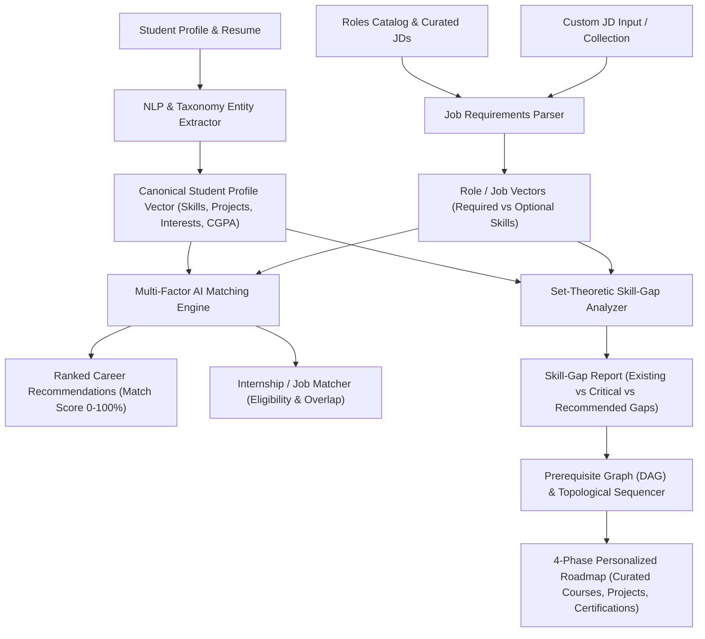

# AI CareerMate: Algorithm Specification & System Architecture
## Smart Career Guidance, Internship & Skill Roadmap System

---

### Executive Overview & Problem Context
Students frequently encounter severe friction when transitioning from academic environments to industry careers:
1. **Ambiguity in Role Suitability:** Unclear mapping between university coursework, personal passions, and dynamic industry roles.
2. **Hidden Skill Deficiencies:** Inability to pinpoint the exact difference between their current skills and modern job requirements.
3. **Inefficient Internship Discovery:** Applying blindly to hundreds of job descriptions (JDs) without understanding compatibility.
4. **Lack of Structured Learning Pathways:** Knowing what is missing but having no sequential, milestone-based roadmap with curated resources.

**AI CareerMate** solves these challenges by combining NLP entity recognition, multi-factor vector space scoring, set-theoretic skill gap diagnostics, and DAG topological prerequisite sequencing.

---

### System Architecture Flow



---

### Mathematical Modeling & Formal Formulations

#### 1. Formal Student Profile Representation
A student profile is formally represented as a 6-tuple:
$$\mathcal{S} = \langle E, \mathcal{K}_s, \mathcal{P}, \mathcal{C}, \mathcal{I}, R_{target} \rangle$$
Where:
- $E = \langle \text{degree}, \text{institution}, \text{cgpa}, \text{grad\_year} \rangle$: Academic credentials.
- $\mathcal{K}_s = \{ (k_i, \mu(k_i)) \mid k_i \in \Omega_{skills}, \mu(k_i) \in [0.1, 1.0] \}$: Set of verified skills with proficiency factors $\mu(k_i)$ ($\text{Beginner}=0.5, \text{Intermediate}=0.75, \text{Advanced}=0.9$).
- $\mathcal{P} = \{ p_j = \langle \text{title}, \text{tech\_stack}_j, \text{description} \rangle \}$: Completed portfolio projects.
- $\mathcal{C} = \{ c_l = \langle \text{title}, \text{issuer}, \text{year} \rangle \}$: Industry credentials.
- $\mathcal{I} \subseteq \Omega_{domains}$: Explicit career domain interests.
- $R_{target} \in \mathcal{R}$: Chosen career destination.

#### 2. Formal Role & Job Representation
A career role or internship is represented as:
$$\mathcal{J} = \langle id, \text{title}, \text{domain}, \mathcal{K}_{req}, \mathcal{K}_{opt}, \text{cgpa}_{min}, \vec{V}_{jd} \rangle$$
Where:
- $\mathcal{K}_{req} \subset \Omega_{skills}$: Mandatory core competencies.
- $\mathcal{K}_{opt} \subset \Omega_{skills}$: Secondary differentiator competencies.
- $\text{cgpa}_{min}$: Minimum academic cut-off.
- $\vec{V}_{jd} \in \mathbb{R}^D$: TF-IDF term vector of the full job description.

#### 3. Multi-Factor Role Match Score Formula
The total composite match score $M(\mathcal{S}, \mathcal{J}) \in [0, 100]$ combines direct skill overlap, portfolio projects, career interests, and academic fit:

$$M(\mathcal{S}, \mathcal{J}) = \left[ w_1 \cdot \Phi_{core}(\mathcal{S}, \mathcal{J}) + w_2 \cdot \Phi_{sec}(\mathcal{S}, \mathcal{J}) + w_3 \cdot \Phi_{proj}(\mathcal{S}, \mathcal{J}) + w_4 \cdot \Phi_{int}(\mathcal{S}, \mathcal{J}) \right] \times \Gamma_{cgpa}(\mathcal{S}, \mathcal{J}) \times 100$$

##### Parameter Weights:
- $w_1 = 0.50$ (Core Skills Overlap)
- $w_2 = 0.20$ (Secondary / Good-to-have Skills Overlap)
- $w_3 = 0.15$ (Portfolio Project Relevance)
- $w_4 = 0.15$ (Career Interest Alignment)
$$\sum_{i=1}^4 w_i = 1.0$$

##### Component Formulations:
1. **Core Skills Overlap:**
   $$\Phi_{core}(\mathcal{S}, \mathcal{J}) = \frac{\sum_{k \in \mathcal{K}_{req} \cap \mathcal{K}_s} \mu(k)}{|\mathcal{K}_{req}|}$$

2. **Secondary Skills Overlap:**
   $$\Phi_{sec}(\mathcal{S}, \mathcal{J}) = \frac{\sum_{k \in \mathcal{K}_{opt} \cap \mathcal{K}_s} \mu(k)}{|\mathcal{K}_{opt}|}$$

3. **Project Relevance:**
   $$\Phi_{proj}(\mathcal{S}, \mathcal{J}) = \min\left(1.0, \frac{\sum_{p \in \mathcal{P}} |\text{tech}(p) \cap (\mathcal{K}_{req} \cup \mathcal{K}_{opt})|}{4}\right)$$

4. **Interest Alignment:**
   $$\Phi_{int}(\mathcal{S}, \mathcal{J}) = \begin{cases} 1.0 & \text{if } \text{domain}(\mathcal{J}) \in \mathcal{I} \\ 0.2 & \text{otherwise (baseline)} \end{cases}$$

5. **Academic Eligibility Gating Multiplier:**
   $$\Gamma_{cgpa}(\mathcal{S}, \mathcal{J}) = \begin{cases} 1.0 & \text{if } \text{cgpa}(S) \ge \text{cgpa}_{min}(\mathcal{J}) \\ 0.85 & \text{if } \text{cgpa}(S) < \text{cgpa}_{min}(\mathcal{J}) \end{cases}$$

---

#### 4. TF-IDF & Cosine Similarity Formulation
For custom text inputs and semantic resume-to-JD matching:
$$\text{TF}(t, d) = \frac{f_{t, d}}{\sum_{t' \in d} f_{t', d}}$$
$$\text{IDF}(t, \mathcal{D}) = \ln\left( \frac{|\mathcal{D}| + 1}{|\{d \in \mathcal{D} : t \in d\}| + 1} \right) + 1$$
$$\vec{V}_d(t) = \text{TF}(t, d) \times \text{IDF}(t, \mathcal{D})$$
$$\text{CosineSim}(\vec{V}_S, \vec{V}_J) = \frac{\vec{V}_S \cdot \vec{V}_J}{\|\vec{V}_S\|_2 \|\vec{V}_J\|_2} = \frac{\sum_{t} \vec{V}_S(t) \vec{V}_J(t)}{\sqrt{\sum_t (\vec{V}_S(t))^2} \sqrt{\sum_t (\vec{V}_J(t))^2}}$$

---

#### 5. Set-Theoretic Skill-Gap Diagnostic Formulation
Given student skill set $\mathcal{K}_s$ and job requirements:
- **Existing Competencies:**
  $$\mathcal{K}_{exist} = \mathcal{K}_s \cap (\mathcal{K}_{req} \cup \mathcal{K}_{opt})$$
- **Critical Skill Deficiencies:**
  $$\mathcal{K}_{missing, crit} = \mathcal{K}_{req} \setminus \mathcal{K}_s$$
- **Recommended Skill Deficiencies:**
  $$\mathcal{K}_{missing, opt} = \mathcal{K}_{opt} \setminus \mathcal{K}_s$$

##### Gap Severity Function:
$$\text{Severity}(k) = \begin{cases} \text{"CRITICAL"} & \text{if } k \in \mathcal{K}_{missing, crit} \\ \text{"RECOMMENDED"} & \text{if } k \in \mathcal{K}_{missing, opt} \end{cases}$$

##### Time-to-Close Gap Latency:
$$\tau_{total} = \left\lceil \eta \times \sum_{k \in \mathcal{K}_{missing}} \tau(k) \right\rceil$$
Where $\tau(k)$ is the individual skill acquisition duration (weeks) and $\eta = 0.75$ represents concurrent learning concurrency.

---

#### 6. Directed Acyclic Graph (DAG) Prerequisite Traversal for Roadmaps
Learning cannot happen randomly; mastering `PyTorch` requires `Python` and `Deep Learning` fundamentals.
Let $G = (V, E)$ be a directed acyclic graph where:
- $V = \mathcal{K}_{missing}$
- Directed edge $(u, v) \in E \iff \text{Skill } u \text{ is a prerequisite for Skill } v$.

```
Python ----> NumPy/Pandas ----> Machine Learning ----> Deep Learning ----> PyTorch/NLP
Linux  ----> Docker        ----> Kubernetes
Git    ----> CI/CD
```

##### Topological Sorting (Kahn's Algorithm by Milestone Levels):
1. Compute in-degree $\delta_{in}(v)$ for each $v \in V$.
2. Initialize Queue $Q_1 = \{ v \in V \mid \delta_{in}(v) = 0 \}$ (Level 1: Foundations).
3. For each milestone level $i$:
   - Set $\text{Phase}_i = Q_i$.
   - For $u \in Q_i$, decrement $\delta_{in}(v)$ for all $(u, v) \in E$.
   - $Q_{i+1} = \{ v \mid \delta_{in}(v) = 0 \text{ and not yet scheduled} \}$.
4. Map resulting levels into 4 Sequential Phases:
   - **Phase 1 (Weeks 1-3):** Foundations & Prerequisite Tools
   - **Phase 2 (Weeks 4-7):** Core Engineering & Framework Mastery
   - **Phase 3 (Weeks 8-10):** Cloud, Scalability & Advanced Integration
   - **Phase 4 (Weeks 11-12):** Capstone Projects, Certifications & Placement Action Items

---

### Step-by-Step Algorithm Pseudo-Code

#### Algorithm 1: Entity Recognition & Resume Extraction
```text
INPUT: Raw Resume Text T, Canonical Skill Taxonomy Omega
OUTPUT: Parsed Profile Object S_parsed

1. Normalize T -> lowercased, punctuation stripped to whitespaces
2. Extract Email via Regex: [a-zA-Z0-9._%+-]+@[a-zA-Z0-9.-]+\.[a-zA-Z]{2,}
3. Extract CGPA via Regex: (?:cgpa|gpa)\s*[:=]?\s*([0-9]\.[0-9]{1,2})
4. Initialize ExtractedSkills = EmptySet
5. FOR each (canonical_name, aliases) in Omega DO:
       FOR each alias in aliases DO:
           IF regex_match(r'\b' + alias + r'\b', T) THEN:
               ExtractedSkills.add(canonical_name)
               BREAK
       END FOR
   END FOR
6. Convert ExtractedSkills to objects with default proficiency Intermediate (0.75)
7. RETURN S_parsed
```

#### Algorithm 2: Multi-Factor Career Recommendation
```text
INPUT: Student Profile S, Roles Catalog R_list
OUTPUT: Ranked Recommendations List Rec_list

1. Rec_list = []
2. FOR each role in R_list DO:
       score = CalculateRoleMatchScore(S, role)
       Rec_list.append({
           role_id: role.id,
           role_name: role.role_name,
           match_score: score,
           matched_skills: role.core_skills ∩ S.skills,
           missing_skills: role.core_skills \ S.skills
       })
   END FOR
3. Sort Rec_list descending by match_score
4. RETURN Rec_list
```

#### Algorithm 3: Fine-Grained Skill Gap Diagnostic
```text
INPUT: Student Profile S, Target Entity T (Role or Job)
OUTPUT: Skill Gap Diagnostic Report Report

1. K_req = T.required_skills
2. K_opt = T.optional_skills
3. Existing = S.skills ∩ (K_req ∪ K_opt)
4. MissingCrit = K_req \ S.skills
5. MissingOpt = K_opt \ S.skills
6. Calculate weighted match percentage
7. Estimate acquisition weeks = ceil(0.75 * Sum(weeks(k) for k in MissingCrit ∪ MissingOpt))
8. Build structured Report with Severity tags and reason explanations
9. RETURN Report
```

#### Algorithm 4: Dynamic 4-Phase Learning Roadmap
```text
INPUT: Missing Skills List K_missing, Target Role Title Title
OUTPUT: 4-Phase Sequential Roadmap Object Roadmap

1. Partition K_missing into Phase 1 (Basics/Tools), Phase 2 (Frameworks), Phase 3 (Cloud/Advanced) using dependency graph
2. FOR each missing skill DO:
       Fetch curated verified learning resources (Coursera, freeCodeCamp, MIT)
       Attach hands-on micro-project
       Attach relevant industry certification
   END FOR
3. Construct Phase 4:
       Generate 2 Production-Grade Capstone Showcase Projects
       Generate Industry-Recognized Certifications (AWS, DeepLearning.AI, CompTIA, Meta)
       Generate Placement Action Checklist (GitHub, Resume metrics, Mock interviews)
4. Assemble 4-phase milestone timeline
5. RETURN Roadmap
```

---

### Verification & Compliance Matrix

| Requirement from Problem Statement | Module & Implementation Status | Algorithmic Mechanism |
| :--- | :--- | :--- |
| **Student registration/login** | `server.mjs` (`/api/auth/*`), SQLite `users` table | Secure SHA-256 password hashing & session management |
| **Student profile and resume upload** | `server.mjs` (`/api/profile`, `/api/resume/parse`) | Regex boundary entity extraction + structured profile sync |
| **Education, skills, projects, certifications** | SQLite `profiles` table, interactive forms & chips | 4-tier structured data schema with editable proficiencies |
| **Career interest & target-role selection** | UI Selector, `roles_catalog` | Domain vector mapping & target role benchmarking |
| **Job/internship information** | SQLite `jobs` table, pre-seeded catalog | Real-world internships with requirements & CGPA cutoffs |
| **Job Description (JD) input or collection** | `POST /api/jobs/custom` & UI JD Analyzer | Real-time NLP skill extraction from arbitrary pasted text |
| **AI-based career recommendation** | `POST /api/analyze/career` | 4-Factor weighted composite scoring algorithm |
| **Skill-gap analysis** | `POST /api/analyze/skill-gap` | Set-theoretic symmetric difference & severity matrix |
| **Internship/job matching** | `POST /api/analyze/internships` | Overlap scoring + CGPA eligibility gating |
| **Personalized learning roadmap** | `POST /api/analyze/roadmap` | DAG topological sort into 4 milestone phases |
| **Curated technologies & resources** | Embedded Knowledge Base in `server.mjs` | Verified free courses, docs, projects, and certifications |
| **Expected Impact** | Full interactive SPA at `http://localhost:3000` | Real-time diagnostic empowering student career readiness |

---

### Academic & Practical Impact
1. **Reduces Career Ambiguity:** Replaces guesswork with quantified, evidence-based role match scores.
2. **Accelerates Upskilling:** Directs student focus to the high-severity 20% of missing skills that unlock 80% of internship eligibility.
3. **Actionable Outcomes:** Every missing skill is paired with a free learning resource, an exact project to build, and a recognized credential to earn.
